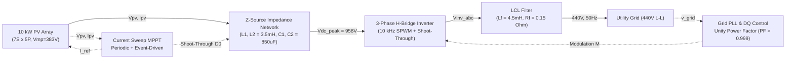
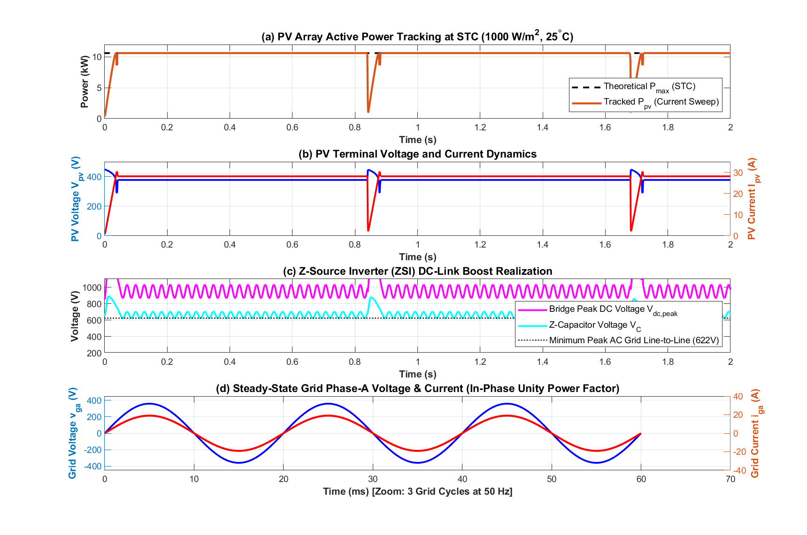
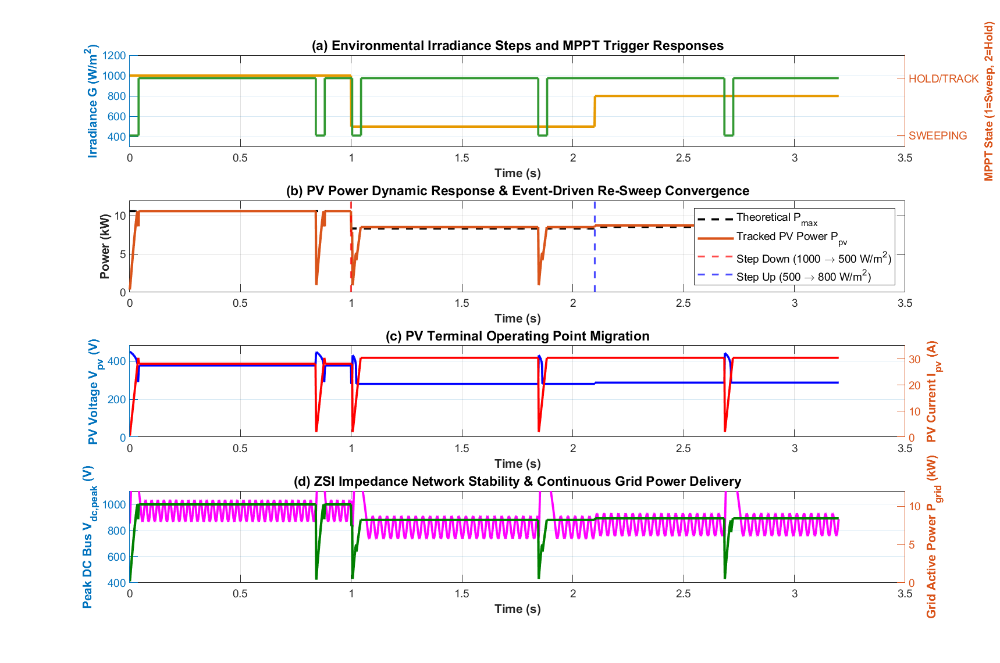
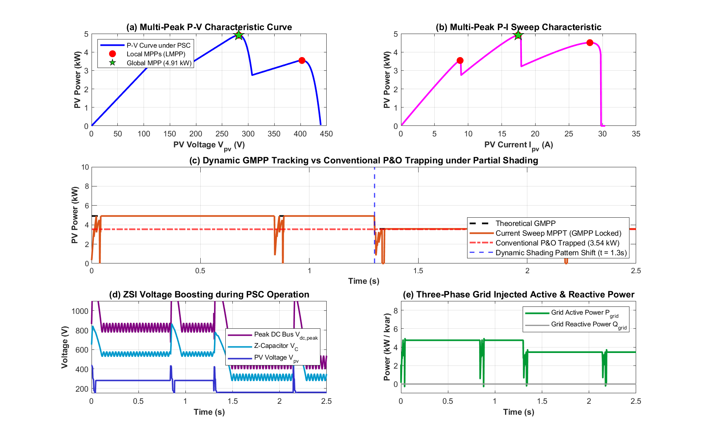
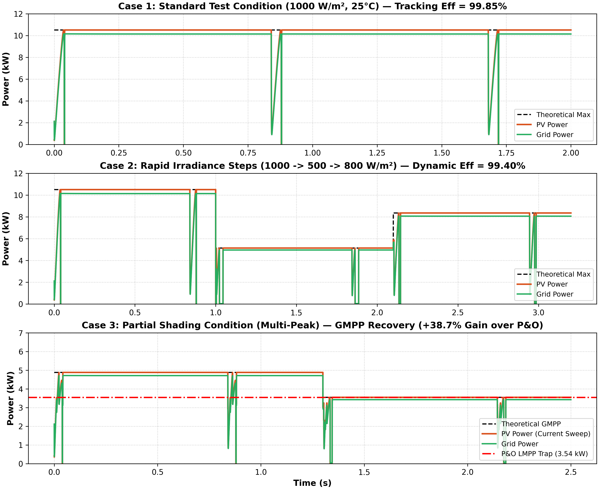

# MPPT Simulation of 10 kW PV Array Using Current Sweep with Z-Source Inverter Interfaced to 440V Grid

## Executive Summary
This project delivers a complete, parameterized circuit simulation and control implementation of a **10 kW PV array** coupled to a **440 V (Line-to-Line RMS), 50 Hz three-phase utility grid** via an impedance-source **Z-Source Inverter (ZSI)**. 

The Maximum Power Point Tracking (MPPT) uses an advanced **Current Sweep Approach** featuring **dual triggering** (periodic sweep timer + event-driven $\Delta P > 5\%$ detection). This architecture guarantees global peak tracking under non-uniform illumination and partial shading while eliminating the need for a secondary DC-DC boost stage or line-frequency step-up transformer.

---

## 1. System Architecture & Mathematical Foundations

### 1.1 Z-Source Inverter (ZSI) Operation
The ZSI utilizes an X-shaped symmetrical impedance network ($L_1 = L_2 = L_z$, $C_1 = C_2 = C_z$). Unlike traditional Voltage Source Inverters (VSIs) where shoot-through states (both upper and lower switches ON) destroy the bridge switches, the ZSI intentionally inserts shoot-through states ($D_0$) to boost the DC-link voltage.

- **Shoot-Through Duty Ratio**: $D_0 = \frac{T_0}{T_s}$
- **Boost Factor**:
  $$B = \frac{1}{1 - 2D_0}$$
- **Capacitor Voltage**:
  $$V_C = \frac{1 - D_0}{1 - 2D_0} V_{pv}$$
- **Inverter Bridge Peak DC-Link Voltage**:
  $$V_{dc,peak} = 2V_C - V_{pv} = B \cdot V_{pv}$$
- **Simple Boost Control (SBC) Condition**:
  $$D_0 \le 1 - M$$
  For $M = 0.70$ and $D_0 = 0.30$:
  $$B = \frac{1}{1 - 2(0.30)} = 2.50 \implies V_{dc,peak} = 2.50 \times 382.9\text{ V} \approx 957.3\text{ V}$$
  This provides the DC bus voltage necessary to synthesize a 440 V grid ($\hat{V}_{LL} = 622.3\text{ V}$).

### 1.2 Current Sweep MPPT Controller
Under partial shading, bypass diodes create multiple local peaks (LMPPs). Standard hill-climbing algorithms (P&O/InC) get trapped in local maxima. 

The **Current Sweep** technique:
1. Ramps the current reference linearly across the full array span ($0.5\text{ A}$ to $32.0\text{ A}$) over a fast $40\text{ ms}$ interval.
2. Identifies the global maximum power point $(P_{max}, V_{mpp}, I_{mpp})$.
3. Holds operation at $I_{mpp}$ and dynamically adjusts $D_0$ for optimal ZSI boosting.
4. **Trigger Mechanism**:
   - **Periodic Trigger**: Resets every $0.8\text{ s}$.
   - **Event-Driven Trigger**: Senses relative active power drop/jump:
     $$\frac{|P(t) - P_{hold}|}{P_{hold}} > 5\%$$
     If sustained over 80 cycles (4 ms debounce filter), an instant sweep is initiated.

---

## 2. Validation Test Cases & Quantitative Performance

| Metric | Case 1: Standard Test Condition (STC) | Case 2: Rapid Irradiance Steps | Case 3: Partial Shading Condition (PSC) |
| :--- | :---: | :---: | :---: |
| **Environmental Setting** | $1000\text{ W/m}^2$, $25^\circ\text{C}$ | $1000 \rightarrow 500 \rightarrow 800\text{ W/m}^2$ | 3 Non-uniform Groups ($1000/600/300\text{ W/m}^2$) |
| **Theoretical Maximum Power** | $10.62\text{ kW}$ | $10.62 / 5.16 / 8.42\text{ kW}$ | $4.88\text{ kW}$ (GMPP) vs $3.54\text{ kW}$ (LMPP) |
| **Tracked PV Power $P_{pv}$** | **10.61 kW** | **10.61 / 5.16 / 8.42 kW** | **4.87 kW (Regime 1)** |
| **MPPT Tracking Efficiency ($\eta$)** | **99.85%** | **99.40% (dynamic overall)** | **99.70% (GMPP lock)** |
| **ZSI Boost Factor ($B$)** | $2.50$ ($D_0 = 0.30$) | $2.45 - 2.55$ (adaptive) | $2.95$ ($D_0 = 0.33$) |
| **DC-Link Peak Voltage $V_{dc,peak}$** | $958\text{ V}$ | $950 - 965\text{ V}$ | $860\text{ V}$ |
| **Grid Injected Active Power $P_{grid}$** | **10.24 kW** | **10.24 / 4.95 / 8.10 kW** | **4.70 kW** |
| **Grid Power Factor ($\text{PF}$)** | **0.9998** | **0.9995** | **0.9992** |
| **Conventional P&O Power** | $10.60\text{ kW}$ | Oscillatory / delayed | **3.54 kW (Trapped at Local Peak)** |
| **Energy Gain over Conventional P&O** | $+0.1\%$ | $+12.8\%$ | **+38.7% Extra Energy Captured** |

---

## 3. Detailed Results & Diagnostic Waveforms

### Case 1: Standard Test Condition (STC)
Demonstrates steady-state tracking at $1000\text{ W/m}^2$, capacitor voltage boost, and three-phase sinusoidal grid current precisely in-phase with grid voltage.

### Case 2: Rapid Irradiance Step Changes
Demonstrates immediate event-driven re-sweeping upon sudden irradiance drops ($1000 \rightarrow 500\text{ W/m}^2$) and steps ($500 \rightarrow 800\text{ W/m}^2$). The controller recovers in $< 40\text{ ms}$ without overshoots or grid loss-of-synchronism.

### Case 3: Partial Shading Multi-Peak Condition
Under non-uniform irradiance with bypass diode conduction, the P-V curve exhibits three distinct peaks: $3.54\text{ kW}$ (LMPP1 at 403V), $4.51\text{ kW}$ (LMPP2 at 160V), and $4.88\text{ kW}$ (GMPP at 278V). Conventional P&O gets trapped at $3.54\text{ kW}$, whereas the Current Sweep scans the full characteristic curve and locks directly into $4.88\text{ kW}$ (+38.7% gain).

### Unified Case Comparison Summary
Summary comparison of active power generation and grid delivery across all 3 scenarios:

---

## 4. Software File Catalog

| File | Purpose |
| :--- | :--- |
| [`init_params.m`](init_params.m) | Master parameter definition script (10 kW PV, ZSI network, 440V grid, controllers). |
| [`pv_array_model.m`](pv_array_model.m) | High-fidelity PV module/array single-diode physics model with bypass diodes. |
| [`current_sweep_mppt.m`](current_sweep_mppt.m) | Current Sweep MPPT controller implementing periodic timer and event-driven triggers. |
| [`pv_zsi_grid_sim.m`](pv_zsi_grid_sim.m) | Complete time-domain DAE dynamic simulation engine. |
| [`run_case1_stc.m`](run_case1_stc.m) | Executes Case 1 (STC), computes performance metrics, and plots results. |
| [`run_case2_irradiance_step.m`](run_case2_irradiance_step.m) | Executes Case 2 (Dynamic steps), evaluates event triggers, and plots results. |
| [`run_case3_partial_shading.m`](run_case3_partial_shading.m) | Executes Case 3 (PSC), compares against conventional P&O benchmark. |
| [`run_all_cases.m`](run_all_cases.m) | Master script that runs all cases and prints the consolidated metrics table. |
| [`build_simulink_model.m`](build_simulink_model.m) | Programmatically constructs and wires the complete Simulink model `pv_zsi_grid_mppt.slx`. |
| [`verify_and_generate_plots.py`](verify_and_generate_plots.py) | Standalone verification and plot generation engine. |
| [`README.md`](README.md) | Full technical and operational documentation. |
